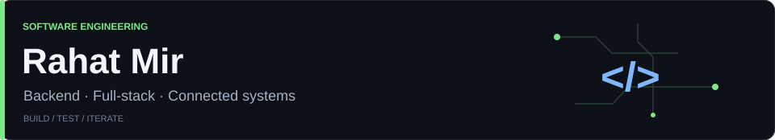
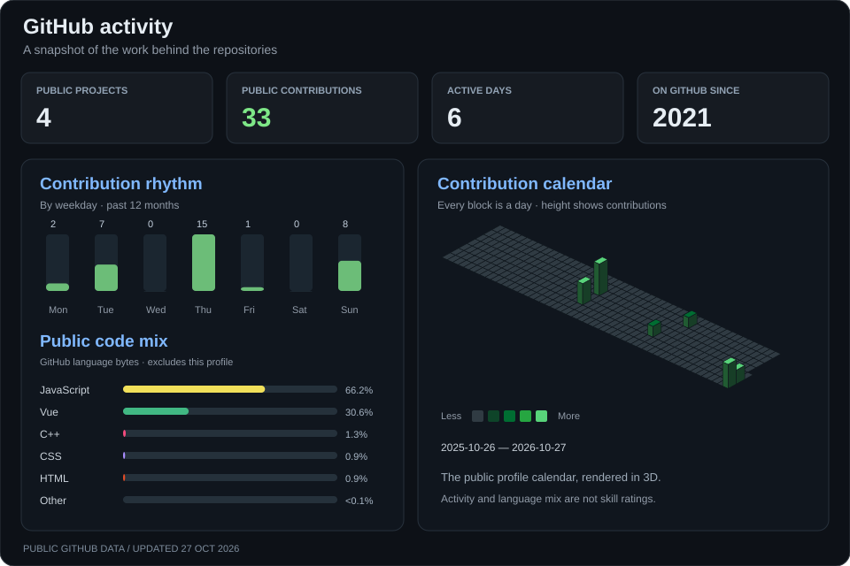

  

Software Engineering student at the **University of Gothenburg**, currently on exchange at the **National University of Singapore**. I enjoy connecting APIs, data and interfaces, then making their behaviour easier to test and understand.

### Technologies I work with

  

**Also:** SQL · MQTT · API testing · React Native / Expo

### GitHub, at a glance

  

[Metric definitions and sources](docs/profile-metrics.md) · [Public snapshot](data/public-metrics.json)

### Selected projects

| Project | What it explores | Stack |
| --- | --- | --- |
| [**StudyBuddy**](https://github.com/Lifelessdice/Study-Buddy) | University study workspace with notes, quizzes, PDF processing and optional AI-assisted revision. **Team project.** | Vue · Express · MongoDB |
| [**SmartSprout**](https://github.com/Lifelessdice/Plant-Sprouts-App) | Sensor-to-dashboard plant monitoring through a Wio Terminal and MQTT. **Team project.** | React Native · Node.js · Firebase |
| [**Flight Deal Tracker**](https://github.com/Lifelessdice/singapore-flight-deal-tracker) | Scheduled fare monitoring, statistical comparisons, quota controls and Discord alerts. | JavaScript · GitHub Actions |

<strong>My contributions to the team projects</strong>

**StudyBuddy:** Postman API checks, shared note-validation and AI-handler refactoring, PDF-processing changes and responsive UI work.

**SmartSprout:** backend development, the backend MQTT connection and displaying sensor readings in the frontend.

These are individual contributions within shared team work; the project repositories retain the wider team context.

[Learning journal →](https://github.com/Lifelessdice/ml-learning-log)
